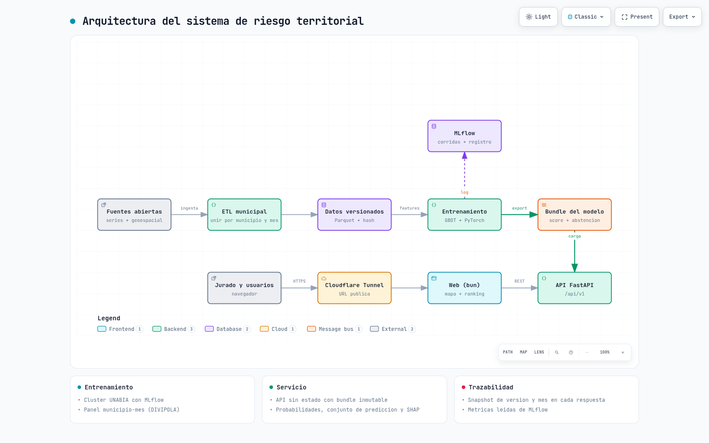
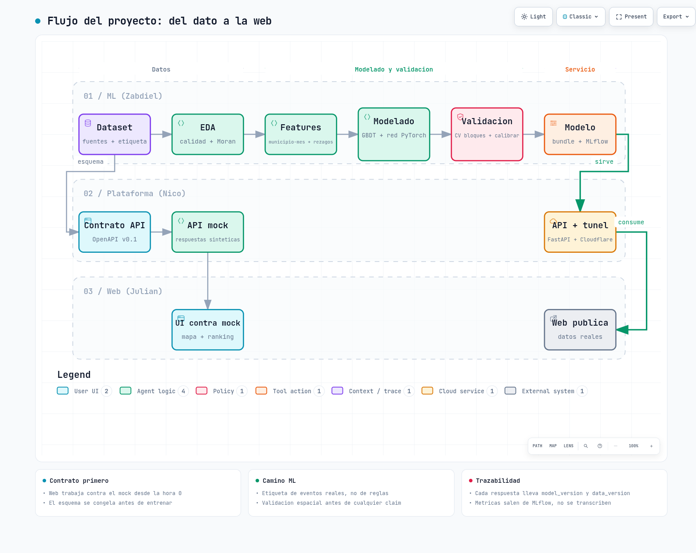
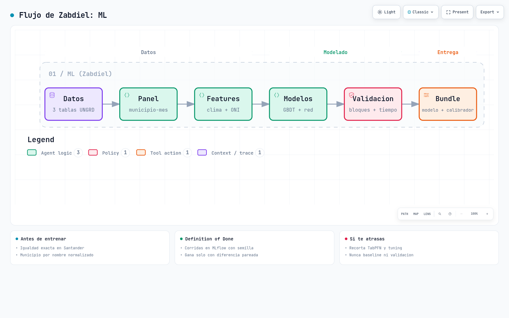
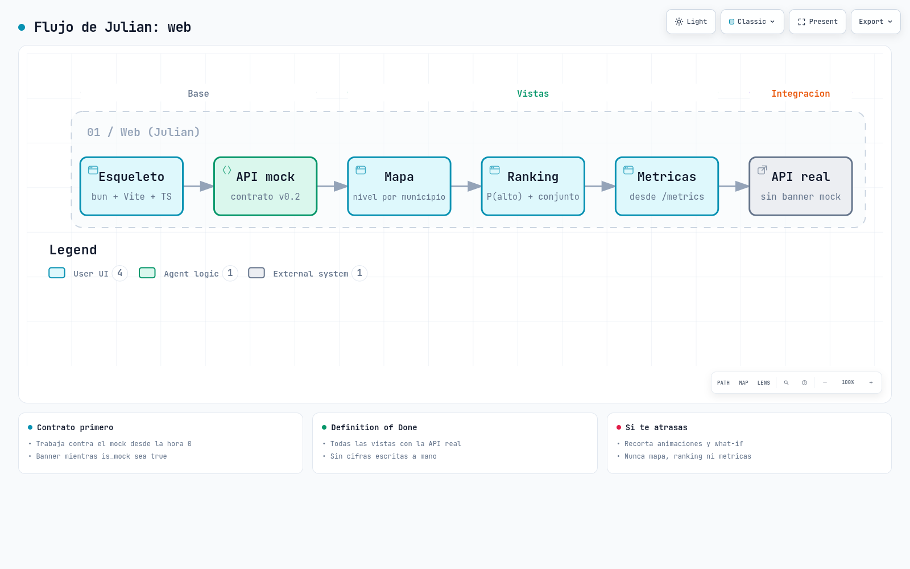
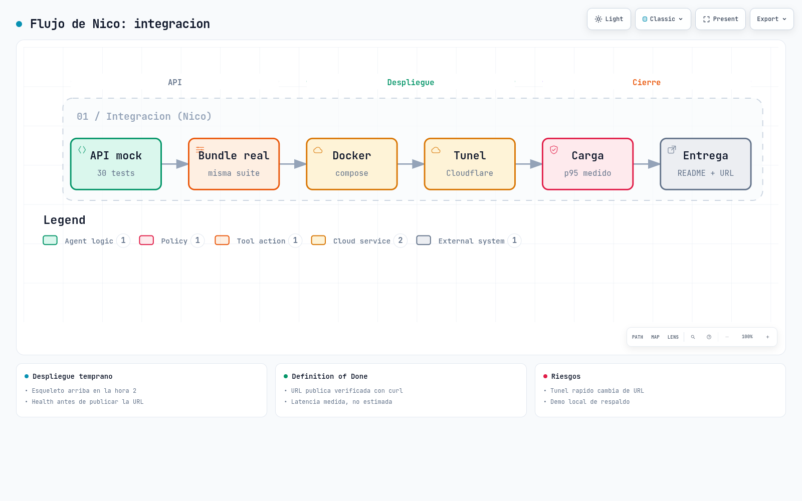

# CIAI: priorizacion de zonas de riesgo (categoria AVANZADO)

Solucion de Machine Learning que estima y prioriza el riesgo de emergencias por municipio de Santander, con incertidumbre, explicabilidad, API y prototipo web.

Estado: planificacion, investigacion y API mock completas; el modelo aun no esta entrenado. Los resultados se publican aqui cuando salgan de MLflow, nunca antes.

## Arquitectura y flujo

Los diagramas son interactivos (descarga el HTML y abrelo en el navegador: busqueda, zoom y recorrido de rutas); abajo, su captura.

### Arquitectura del sistema

[Abrir interactivo](docs/flows/arquitectura-sistema.html)



### Flujo del proyecto: del dato a la web

[Abrir interactivo](docs/flows/flujo-proyecto.html)



## Workflow de cada persona

| Persona | Tareas | Diagrama |
|---|---|---|
| Zabdiel, ML | [04-tareas-zabdiel-ml.md](docs/plan/04-tareas-zabdiel-ml.md) | [interactivo](docs/flows/flujo-ml.html) |
| Julian, web | [05-tareas-julian-web.md](docs/plan/05-tareas-julian-web.md) | [interactivo](docs/flows/flujo-web.html) |
| Nico, integracion | [06-tareas-nico-integracion.md](docs/plan/06-tareas-nico-integracion.md) | [interactivo](docs/flows/flujo-integracion.html) |

### Zabdiel: ML



### Julian: web



### Nico: integracion y despliegue



## Donde esta cada cosa

| Documento | Contenido |
|---|---|
| `AGENTS.md` | Reglas del equipo y de los agentes, reglas de Engram y skills recomendadas |
| `docs/plan/00-requisitos-entregables.md` | Los 12 requisitos AVANZADO y su evidencia |
| `docs/plan/01-roles-cronograma.md` | Roles, hitos y flujo de cada persona (5 h) |
| `docs/plan/02-entorno-dependencias.md` | uv, PyTorch, bun, cluster UNABIA, despliegue |
| `docs/plan/03-contrato-api.md` | Contrato entre ML y web (v0.2, ejecutable) |
| `docs/plan/07-engram-uts.md` | Memoria compartida del equipo: como conectarse |
| `docs/research/` | Datasets, modelos, validacion, MLOps, ideas, datos de Colombia, estado del arte |
| `skills/` | Instrucciones por area (ML, web, MLOps, Engram) |

## Decisiones clave (con evidencia en docs/research)

- Etiqueta real: emergencias UNGRD 2019-2025 (2 641 eventos en Santander), panel municipio x mes. Las coordenadas de la fuente son inservibles y el DIVIPOLA de 2025 esta corrupto, por eso la unidad es el municipio (87).
- Modelos: baseline, GBDT, red PyTorch propia, TabPFN opcional (pesos no comerciales); validacion por bloques de municipios y particion temporal.
- Incertidumbre: calibracion, conjunto de prediccion con cobertura empirica y abstencion cuando no hay soporte.
- Los tres niveles son frecuencia relativa de emergencias reportadas, no severidad ni alerta oficial.

## Inicio rapido

```bash
git clone https://github.com/nicolas2601/ciai-riesgo-avanzado && cd ciai-riesgo-avanzado
uv sync --group dev
uv run pytest app/api -q                      # contrato de la API
uv run uvicorn app.api.main:app --reload      # API mock (is_mock = true)
cd app/web && bun install && bun dev         # web (cuando exista)
```

Fuentes de datos y licencias: ver `docs/research/01-datasets.md` y `06-datos-colombia.md`.
