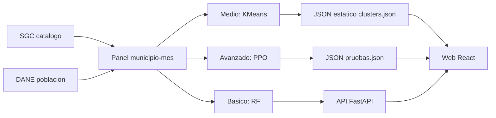

# Documentación del proyecto: riesgo sísmico en Santander

Hackathon CIAI UTSmart 2026, categoría Avanzado. Equipo **Syntax error II** (UNAB).
Toda cifra de este documento proviene de un archivo del repositorio, citado en la misma sección. Lo que no está en un archivo no se afirma. Las desviaciones frente a lo exigido por el reto están en `docs/AUDITORIA_REQUISITOS.md`.

## 1. Problema y contexto

Santander es uno de los departamentos con mayor actividad sísmica de Colombia. Bajo la Mesa de Los Santos está el Nido Sísmico de Bucaramanga, una de las zonas de sismicidad intermedia más activas del mundo, con cientos de sismos por mes. El Servicio Geológico Colombiano (SGC) publica cada evento. El reto (texto oficial en `docs/research/source/pagina-reto-2026-10-13.txt`, fuente https://ciaiuts.com/eventos/hackaton-utsmart-2026) pide convertir esos datos en modelos de Machine Learning que analicen y clasifiquen el riesgo sísmico de una zona de Santander.

Reglas centrales del reto: datos reales de una fuente oficial, modelo entrenado por el equipo y demostrado en vivo, sin presentaciones solo conceptuales ni reglas fijas. Categoría Avanzado: cumplir Básico y Medio, integrar otra fuente oficial y construir una priorización exploratoria con un agente de aprendizaje por refuerzo, con al menos 20 variables.

Por qué importa: una lectura mensual y comparable por municipio de la actividad registrada ayuda a decidir dónde mirar primero. En este proyecto la "priorización" es de **actividad sísmica registrada**, no de daño ni de amenaza oficial.

## 2. Objetivo y alcance

- Objetivo: clasificar la actividad sísmica del mes siguiente por municipio (bajo, medio, alto), agrupar municipios por perfil y priorizar K=5 municipios con un agente de refuerzo.
- Alcance: **priorización exploratoria sobre datos históricos (backtest)**. No es alerta oficial, no predice cuándo ocurrirá un terremoto, no estima daños ni probabilidades oficiales de amenaza (`artifacts/ml/critical_analysis.md`, sección 8; `app/api/service.py`, descripción de la API).
- Unidad: municipio x mes, 87 municipios, 103 meses (2018-03 a 2026-09) (`artifacts/ml/audit_report.md`).

## 3. Fuentes de datos

| Fuente | URL | Descarga | Filtros | Licencia |
|---|---|---|---|---|
| SGC, catálogo sistema antiguo | `https://bdrsnc.sgc.gov.co/paginas1/catalogo/Consulta_Experta/consulsismo3.php` | 2026-10-13 | departamento SANTANDER, 1993-06 a 2018-02, magnitud 0-9, profundidad 0-700 km, un año por consulta | No declarada en los archivos del repo; datos públicos del SGC. Verificar términos antes de redistribuir |
| SGC, catálogo sistema nuevo (Seiscomp) | `https://bdrsnc.sgc.gov.co/paginas1/catalogo/Consulta_Experta_Seiscomp/consulta_sismo.php` | 2026-10-13 | departamento 27-Santander, 2018-03 a la fecha, mismos rangos | Igual |
| DANE, proyecciones de población municipal | `https://www.dane.gov.co/files/censo2018/proyecciones-de-poblacion/Municipal/PPED-AreaMun-2018-2042_VP.xlsx` | 2026-10-13 (09:02-09:07 COT) | DIVIPOLA `68xxx`, años 2018-2026: 87 municipios, 783 filas | La página y el libro no exponen licencia abierta específica; fuente oficial pública. Verificar atribución DANE |
| Polígonos municipales (solo visualización) | `https://raw.githubusercontent.com/caticoa3/colombia_mapa/master/co_2018_MGN_MPIO_POLITICO.geojson` | 2026-10-13 | `DPTO_CCDGO = 68`, simplificación 0,002 grados | **Espejo no oficial de terceros; el repositorio espejo no declara licencia.** Dato de fondo: DANE MGN 2018 |

Detalles verificados:

- SGC: el catálogo tiene dos sistemas con columnas distintas, unificados en el pipeline. Se descargó con `scripts/sgc_download.py` (POST por año). Cada archivo queda con URL, filtros, hora UTC, número de filas y sha256 en `data/sgc/provenance.json` (la primera descarga registrada es `new_2018`, 8.966 filas, 2026-10-13 13:46 UTC). Copias comprimidas en `data/sgc/*.csv.gz`.
- Catálogo unificado: 208.215 filas tras quitar 35 duplicados exactos; old 105.728, new 102.487 (`docs/research/13-eda-sgc.md`).
- DANE: el cruce con los 87 municipios del SGC es 87/87. El SGC escribe "El Carmen" y el DANE "El Carmen de Chucurí" (DIVIPOLA 68235), alias confirmado. SHA-256 del XLSX: `1ea83594ad308becff39934a3977c102919c25740f60439be95d797396d11283` (`docs/research/14-fuente-oficial-2.md`). La población es una **proyección retrospectiva** basada en el censo 2018, no una medición anual.
- Polígonos: 87 features, todos los DIVIPOLA coinciden con la tabla DANE; los servicios oficiales DANE/IGAC no se consultaron (`docs/data/geojson_santander.md`). Solo para dibujar; no sirven para áreas.
- Fuente descartada: UNGRD `wwkg-r6te` (solo 3 filas "SISMO" en Santander 2019-2022).

## 4. Pipeline y trazabilidad

```
SGC (2 sistemas) --sgc_download--> data/raw/sgc/*.csv + .meta.json
        |                                  |
        |                       ml.eda.build_panel (+ DANE, DIVIPOLA)
        |                                  v
        |            data/panel/panel_municipio_mes.csv.gz (8.961 x 45)
        |                 |            |                |
        |        ml.src.benchmark  ml.medio.run   ml.src.train_ppo
        |        (Básico)          (Medio)        ml.src.evaluate_rl (Avanzado)
        v                 v            v                v
   EDA 13-eda-sgc   selected_model  clusters.json   ppo_policy.zip
                    metrics.json    kmeans.joblib   metrics_rl_*.json
                          \             |             /
                           app/api (FastAPI)  +  app/web (React)
```

| Paso | Comando | Salida |
|---|---|---|
| Descarga SGC | `uv run --group reto python scripts/sgc_download.py --from-year 1993 --to-year 2026` | `data/raw/sgc/`, `provenance.json` |
| EDA | `uv run --group reto python -m ml.eda.eda_sgc` | `docs/research/13-eda-sgc.md` |
| Panel y diccionario | `uv run --group reto python -m ml.eda.build_panel` | `data/panel/*`, `docs/data/diccionario.md` |
| Básico | `uv run python -m ml.src.benchmark` | `artifacts/ml/{metrics.json,benchmark_val.md,selected_model.joblib}` |
| Auditoría del panel | `uv run python -m ml.src.audit` | `artifacts/ml/audit_report.md` |
| Análisis crítico | `uv run python -m ml.src.analyze` | `artifacts/ml/critical_analysis.md` |
| Medio | `uv run python -m ml.medio.run` | `app/web/public/data/clusters.json`, `ml/medio/kmeans.joblib`, `docs/research/16-medio-clusters.md` |
| PPO | `uv run --group reto python -m ml.src.train_ppo` | `artifacts/ml/rl/ppo_policy.zip`, `ppo_config.json` |
| Evaluación RL | `uv run --group reto python -m ml.src.evaluate_rl --split val` (y `--split test`, una sola vez) | `artifacts/ml/rl/metrics_rl_{val,test}.json` |
| Investigación RL | `uv run --group reto python -m ml.src.rl_experiments` | `artifacts/ml/rl_research/` |

Rastro: hash del panel `92cb622123e471487df9ef6e617023ef216a82617bd3dbc8ffbd5da3db63e400` en `metrics.json`, `audit_report.md` y `metrics_rl_*.json`; semilla 7. Los diagramas del flujo están en `docs/flows/`.

Caveat de reproducibilidad: el panel versionado en el repo permite saltar la descarga. La descarga original y el XLSX del DANE viven en `data/raw/` y `data/external/`, fuera de git; no hay un script versionado que descargue el XLSX del DANE (ver auditoría).

## 5. Datos

### 5.1 Panel municipio x mes

`data/panel/panel_municipio_mes.csv.gz`: 8.961 filas, 45 columnas, 87 municipios, sin duplicados (zona, mes) (`data/panel/metadata.json`, `audit_report.md`). Solo se usa el sistema nuevo (desde 2018-03) para que las magnitudes sean comparables; el sistema antiguo se conserva en el catálogo unificado pero no entra a los conteos.

### 5.2 Variables: 32 features en 6 familias

Diccionario completo con tipo, unidad, fuente y justificación: `docs/data/diccionario.md` (generado por `ml.eda.build_panel`).

| Familia | Variables |
|---|---|
| Actividad | `n_eventos_mes`, `n_eventos_3m`, `n_eventos_12m`, `n_m_ge_3_mes`, `n_m_ge_3_12m`, `n_m_ge_4_mes`, `n_m_ge_4_12m`, `n_m_ge_mc_mes`, `energia_log_3m` |
| Magnitud | `mag_max_mes`, `mag_max_3m`, `mag_media_mes`, `mag_std_mes` |
| Profundidad | `prof_media_mes`, `prof_std_mes`, `frac_prof_lt30`, `frac_30_70`, `frac_70_300`, `frac_gt300` |
| Calidad de localización | `rms_media_mes`, `gap_media_mes`, `fases_media_mes`, `mc_maxc_12m`, `hay_eventos_mes` |
| Recencia y vecindad | `dias_desde_ultimo_evento`, `dias_desde_ultimo_m3`, `n_eventos_vecinos_mes` (radio 50 km), `n_eventos_departamento_mes` |
| Territorio y contexto | `centroid_lat`, `centroid_lon`, `poblacion` (DANE), `year_context` |

Notas: `energia_log_3m` es un índice relativo, no joules. `frac_gt300` es constante (auditoría). Los nulos de historia incompleta se dejan nulos (no se rellenan con el futuro).

### 5.3 Objetivos y balance

Tres objetivos, todos del **mes siguiente completo** (`diccionario.md`):

| Objetivo | Definición |
|---|---|
| `target_clase_mes_siguiente` | alto si hay al menos un M>=4; medio si hay M 3,0-3,9 y ninguno >=4; bajo si no hay M>=3 |
| `target_actividad_m3_mes_siguiente` | indicador de actividad M>=3 (recompensa del RL) |
| `target_n_eventos_mes_siguiente` | conteo de eventos |

Balance: bajo 8.466, medio 242, alto 166, sin objetivo 87. Elegibles con etiqueta: 7.917; fracción baja 0,954. El desbalance es extremo.

### 5.4 Particiones cronológicas y reglas anti-fuga

| Partición | Meses | Filas | bajo / medio / alto |
|---|---|---|---|
| train | 2019-02 a 2024-04 (63) | 5.481 | 5.225 / 145 / 111 |
| val | 2024-05 a 2025-05 (13) | 1.131 | 1.075 / 35 / 21 |
| test | 2025-06 a 2026-08 (15) | 1.305 | 1.245 / 41 / 19 |

Reglas aplicadas (verificadas en código o informes): características calculadas solo con el pasado; imputación y escalado ajustados solo con train; sobremuestreo (ROS, SMOTE) solo sobre train; selección de modelo en validación; test evaluado una vez; ninguna columna de futuro en X (`audit_report.md`); en RL, un corte incompleto se excluye, nunca se rellena con cero.

No aplicadas: no hay embargo entre particiones ni validación por bloques de municipios (la regla 2 de `AGENTS.md` los pide; el código usa solo la división cronológica en `ml/src/data.py`).

### 5.5 Sesgo de detección SGC (hipótesis)

El número de registros crece entre 2008 y 2012 y la magnitud de completitud aproximada baja de 2,8-3,1 (años 90) a 1,4-1,7 (2017+) (`13-eda-sgc.md`). **HIPÓTESIS:** consistente con mejoras de instrumentación y cobertura; el catálogo por sí solo no prueba cambio físico de la amenaza. Los Santos concentra 55,2% de los eventos del sistema nuevo. Por eso el panel usa solo el sistema nuevo, incluye `mc_maxc_12m` y `year_context`, y todo el proyecto habla de "actividad registrada".

## 6. Modelos

### 6.1 Básico: clasificación supervisada

Benchmark A a E en validación (`artifacts/ml/benchmark_val.md`), ordenado por macro-F1:

| Modelo | macro-F1 | Balanced acc. | Accuracy |
|---|---|---|---|
| A. Dummy (clase mayoritaria) | 0,3249 | 0,3333 | 0,9505 |
| B. Regresión logística balanceada | 0,5253 | 0,6759 | 0,7887 |
| C. ROS + regresión logística | 0,5113 | 0,6817 | 0,7790 |
| D. SMOTE + regresión logística | 0,5367 | 0,6914 | 0,8329 |
| **E. Random forest balanceado (elegido)** | **0,5933** | 0,6188 | 0,9576 |

Por qué macro-F1: con 95% de clase baja, la accuracy premia al modelo que siempre dice "bajo" (el dummy saca 0,95). El macro-F1 promedia el F1 de las tres clases por igual y castiga ignorar las raras.

Test (una sola vez, E sin reajuste): macro-F1 **0,5296**, balanced accuracy 0,5757, accuracy 0,9556; dummy en test 0,3255. Por clase en test: bajo F1 0,9801; **medio precisión 0, recall 0, F1 0** (41 casos); alto F1 0,6087 (recall 0,7368, 19 casos) (`metrics.json`). El modelo no resuelve la clase medio. En validación, medio tuvo recall 0,0571.

El RF se entrenó sin ajuste de hiperparámetros (nota "no tuning" en `metrics.json`). El `roc_auc` de la clase alta figura como no disponible. Artefacto: `artifacts/ml/selected_model.joblib`.

### 6.2 Medio: perfiles no supervisados

`docs/research/16-medio-clusters.md`: 87 municipios, 21 variables de perfil, ajuste con datos hasta 2025-05, sin targets. KMeans k=3 (k probado 3 a 7 por silhouette y Davies-Bouldin), n_init 20, semilla 7.

| Métrica | Valor |
|---|---|
| Silhouette | 0,2777 |
| Davies-Bouldin | 1,0623 |
| ARI entre semillas (7 / 21 / 42) | 1,0 / 0,3870 / 1,0 |
| Contraste jerárquico, mismo k | silhouette 0,2854; ARI vs KMeans 0,6792 |

Grupos: 0 (19 municipios; más profundidad somera y gap mayor), 1 (66), 2 (2 municipios, entre ellos Los Santos; más meses con M>=3 y M>=4).

Qué NO significa: los grupos no son bajo/medio/alto ni riesgo oficial, no prueban daño ni causalidad; las métricas son internas, no desempeño fuera de muestra; la estabilidad ante la semilla es parcial (ARI 0,387 con semilla 21); el grupo 2 es de tamaño 2; los centroides y la población pueden dominar los grupos; los rótulos son arbitrarios.

### 6.3 Avanzado: priorización con aprendizaje por refuerzo

**Diseño del entorno** (`ml/src/rl_env.py`, `final_audit.md`):

- Episodio = un corte mensual. El agente elige K=5 municipios distintos (acción `Discrete(N)` con máscara de elegibilidad) antes de ver resultados.
- Observación: `[features (N x F) | máscara (N) | presupuesto (1)]`, float32, orden DIVIPOLA estable.
- Recompensa: 0 en las elecciones intermedias; al completar K, la media de `target_actividad_m3_mes_siguiente` de los elegidos (actividad futura observada; no es daño ni riesgo oficial).
- Algoritmo: MaskablePPO (sb3-contrib), CPU, 8.192 pasos, MLP [64], gamma 1,0, semilla 7, 13,45 s de entrenamiento (`ppo_config.json`, `limitaciones.md`). Preprocesador ajustado solo con train.

**Resultados** (recompensa media por corte, K=5, `artifacts/ml/rl/`):

| Política | Validación (13 cortes) | Test (15 cortes) |
|---|---|---|
| Agente PPO | 0,5231 | 0,4667 |
| Top-K estático (solo train) | 0,5231 | 0,4667 |
| Ranker contextual | 0,4462 | 0,3733 |
| Aleatorio (5 semillas) | 0,0092 | 0,0133 |
| Oráculo (no operativo) | 0,8308 | 0,7867 |

**Colapso.** El agente elige siempre el mismo conjunto `{68418, 68895, 68872, 68235, 68255}` en los 13 cortes de val y en los 15 de test. La diferencia pareada agente menos estático es 0,0 en los 28 cortes. Con las features puestas en cero o tomadas de otro corte, los picks son idénticos en 13/13 cortes: el agente no usa el estado. El municipio 68418 está activo el 100% de los meses. **No existe evidencia de ventaja del RL** (`final_audit.md`, sección 4).

**Por qué.** `rl_research/formulation_audit.md` y `research_report.md` concluyen que el problema es un bandido combinatorio contextual (acciones sin efecto sobre estados futuros, recompensa aditiva, horizonte 1), no un proceso de decisión secuencial. La política óptima aparente es casi constante.

**Investigación adicional** (9 entrenamientos PPO, semillas 7/21/42 por 3 variantes, validación): V0 0,4974 ± 0,032; V1 (recorte de logits) 0,4923 ± 0,027; V2 (codificador por municipio) 0,0257 ± 0,018, explora sin aprender; estático 0,5231. Ninguna variante supera al estático.

**El test ya fue consultado.** El test del RL se evaluó con la política congelada, pero "el test ya estaba expuesto por la pista de referencia: lectura confirmatoria, no firewall intacto" (`research_report.md`). No se reajustó nada tras verlo.

Intervalos (bootstrap circular por bloques de 3 meses, B=10.000, IC 95%): val agente [0,477, 0,549] idéntico al estático; diferencia agente menos ranker en val [0,034, 0,106] y en test [0,029, 0,107] (`final_audit.md`). Con 13 y 15 meses, orientativos.

## 7. Validación e incertidumbre

| Aspecto | Qué hay | Qué falta |
|---|---|---|
| Orden temporal | División cronológica train/val/test, sin mezclar meses | Embargo; validación por bloques de municipios |
| Supervisado | Matrices de confusión y métricas por clase (`metrics.json`); degradación val a test: macro-F1 0,5933 a 0,5296 | Sin intervalos de confianza ni calibración; clase alta con 19-21 casos: métricas orientativas |
| Medio | Silhouette, Davies-Bouldin, ARI entre semillas, contraste jerárquico | Sin validación externa |
| RL | Comparación pareada con baselines, bootstrap por bloques, prueba de uso del estado | Una sola réplica de entrenamiento en la ruta principal; réplicas solo en la investigación |
| Datos | Catálogo retrospectivo/revisado: backtest, no operación "as-of"; población DANE retrospectiva | `year_context` puede memorizar tendencias |

## 8. Arquitectura, API y despliegue



La web lee JSON estáticos de `app/web/public/data/` (`clusters.json`, `inicio.json`, `pruebas.json`, `panel-metadata.json`, `santander_municipios.geojson`) y llama a la API para clasificar. Rutas web (`app/web/src/pages`): `/`, `/basico`, `/medio`, `/avanzado`, `/metodologia`, `/pruebas`, `/presentacion`. Stack: bun, Vite, React, TypeScript, MapLibre.

**API** (`app/api/service.py`, versión 0.2.0, prefijo `/api/v1`, Swagger: https://ciai-api.nicolasmoreno.site/docs). Errores siempre como `{"error": {"code", "message"}}`.

| Método y ruta | Descripción |
|---|---|
| `GET /health` | Liveness y modelos cargados: `{"status":"ok","modelos":{"clasificador":..,"agente":false,"clusters":..},"version":"0.2.0"}` |
| `GET /municipios?mes=YYYY-MM` | 87 municipios con población DANE |
| `GET /panel?mes=YYYY-MM` | Filas del panel del mes (features y objetivos) |
| `POST /clasificar` | Cuerpo `{"mes":"2025-03","divipola":"68001"}`; devuelve clase, probabilidades, `modelo`, `version`, `exploratorio: true` |
| `GET /priorizacion?corte=YYYY-MM&k=5` | Top-k por método: `estatico`, `aleatorio` y `ppo` (lista vacía) |
| `GET /clusters` | Clusters del Medio (503 si no está publicado) |

Ejemplo verificado en `docs/research/17-pruebas-e2e.md`: Bucaramanga 2025-03 devuelve clase "bajo" con probabilidades 0,9306 / 0,0661 / 0,0032. `/clasificar` toma la fila del panel de ese municipio y mes; no recibe variables libres.

**Despliegue.** Web https://ciai.nicolasmoreno.site y API https://ciai-api.nicolasmoreno.site, contenedores en `infra/api` e `infra/web` (API: Docker non-root, sistema de archivos de solo lectura, 768 MB, 1 CPU, sin puertos en el host, entrada solo por túnel Cloudflare). Versiones de la API fijadas a las de `uv.lock` (scikit-learn 1.9.1) por compatibilidad del pickle. CI en `.github/workflows/ci.yml`.

**Release v0.1.0** (GitHub, `scripts/publish_release.sh`), SHA-256:

| Archivo | SHA-256 |
|---|---|
| `selected_model.joblib` | `c770e486d6317fa5aea01ec29e063b6f84186e88e91597571e1fb6f03b1fecdb` |
| `ppo_policy.zip` | `830322ab38e023eee74b21d8a9e65fd976f3c0fb77ed69c34a51295f60357948` |
| `metrics.json` | `61914bd34affe4af96862b65e640de944137beb06f28d85fc8417f83515a67bd` |

(Hashes tomados de la descripción del release en GitHub el 2026-10-13, no de un archivo del repo.)

## 9. Demostración en vivo

Lo que se muestra (rutas verificadas en `17-pruebas-e2e.md`):

1. `/basico`: elegir municipio y mes, pulsar Clasificar; respuesta con la clase y probabilidades.
2. `/medio`: mapa de 87 municipios en 3 grupos (19, 66, 2); al elegir un municipio se muestra su grupo.
3. `/avanzado`: priorización top-5 estática y aleatoria, y el agente.
4. `/metodologia`, `/pruebas`, `/presentacion`: método, resultados y pitch.

Lo que **no corre** en el despliegue: el PPO. La API reporta `agente: false`, devuelve lista vacía para `ppo` y la recompensa real figura "no disponible"; el botón "Ejecutar agente" está deshabilitado y el runtime de RL no está instalado en la imagen (`service.py`, `infra/api/requirements.txt`). El modelo PPO existe (`artifacts/ml/rl/ppo_policy.zip`) y se puede cargar localmente. Quien lo demuestre en vivo debe hacerlo desde el repo con `ml.src.evaluate_rl`, y debe decir que el agente reproduce el top-K estático.

## 10. Limitaciones y riesgos

- El agente de RL colapsa a una política constante equivalente al top-K estático; no hay ventaja demostrada (sección 6.3).
- La clase medio no se detecta en test (F1 0); la clase alta tiene 19-21 casos.
- Backtest sobre un catálogo revisado y población proyectada; no es operación "as-of".
- Sesgo de detección: más registros no es más sismicidad; el 55% de los eventos del sistema nuevo es de Los Santos.
- La segunda fuente oficial aporta una sola variable (`poblacion`); `area_total_o_cabecera` no es km², así que no hay densidad.
- Los polígonos provienen de un espejo no oficial sin licencia declarada; son solo para visualización.
- Sin intervalos de confianza en el supervisado, sin validación espacial, sin embargo temporal.
- La recompensa y los objetivos miden actividad registrada, no daño ni riesgo.
- Dependencia de terceros en el despliegue (Cloudflare bloquea el User-Agent de Python por defecto, error 1010).

## 11. Equipo y roles

Equipo **Syntax error II**, Universidad Autónoma de Bucaramanga (UNAB). Inscrito en la categoría Avanzado.

| Persona | Rol (`AGENTS.md`) |
|---|---|
| Nicolás Moreno | Datos (SGC, DANE), panel y diccionario, Medio, trazabilidad, API, despliegue y entregables |
| Julián Arteaga | Web React: mapa, priorización, grupos, metodología y modo presentación |
| Zabdiel Quintero | Machine Learning: Básico, agente de refuerzo, líneas base y validación |

## 12. Cómo reproducir todo

Requisitos: git, uv, bun, Python 3.11 a 3.13 (`AGENTS.md`).

```bash
git clone https://github.com/nicolas2601/ciai-riesgo-avanzado && cd ciai-riesgo-avanzado
uv sync --group dev --group dl --group reto --group demo

# Datos (opcional: el panel ya esta versionado)
uv run --group reto python scripts/sgc_download.py --from-year 1993 --to-year 2026
uv run --group reto python -m ml.eda.eda_sgc
uv run --group reto python -m ml.eda.build_panel

# Modelos
uv run python -m ml.src.benchmark && uv run python -m ml.src.audit && uv run python -m ml.src.analyze
uv run python -m ml.medio.run
uv run --group reto python -m ml.src.train_ppo
uv run --group reto python -m ml.src.evaluate_rl --split val
uv run --group reto python -m ml.src.evaluate_rl --split test   # una sola vez

# API local (http://localhost:8000/docs) y web (http://localhost:5173)
uv run uvicorn app.api.service:create_app --factory --port 8000
cd app/web && bun install && bun dev

# Pruebas
uv run pytest -q
```

Nota: `uv run uvicorn app.api.main:app` levanta el mock del contrato v0.2 (`is_mock = true`), no el servicio real. Los comandos de ejecución de los módulos fueron tomados de sus docstrings y de los informes generados; la sección de pruebas debe correrse antes de la presentación para confirmar que sigue en verde.
